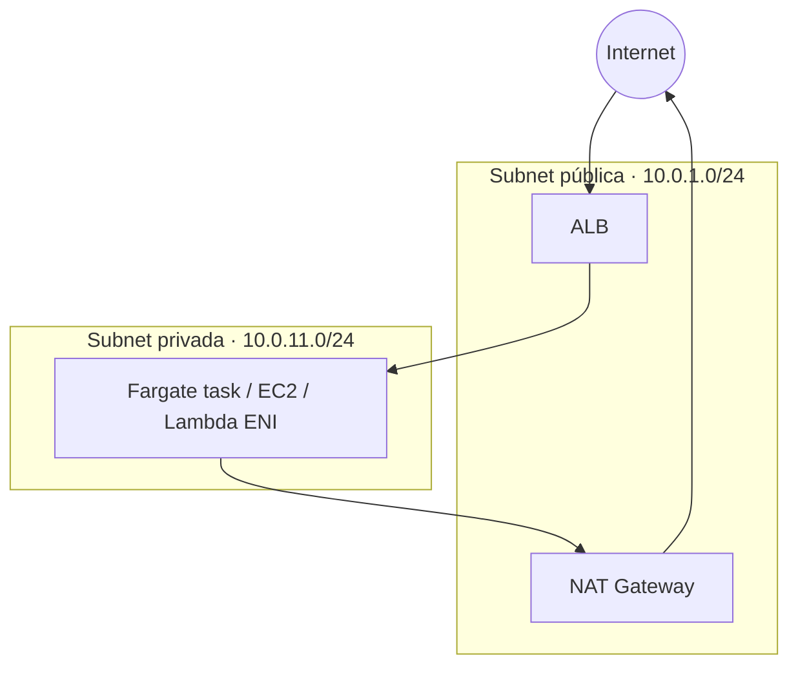
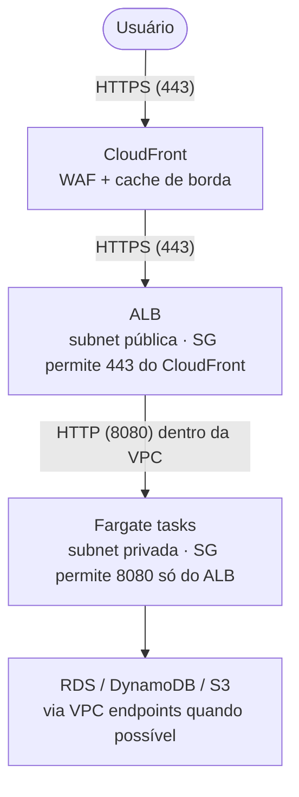
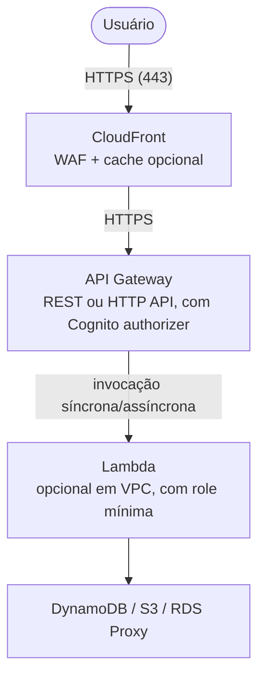
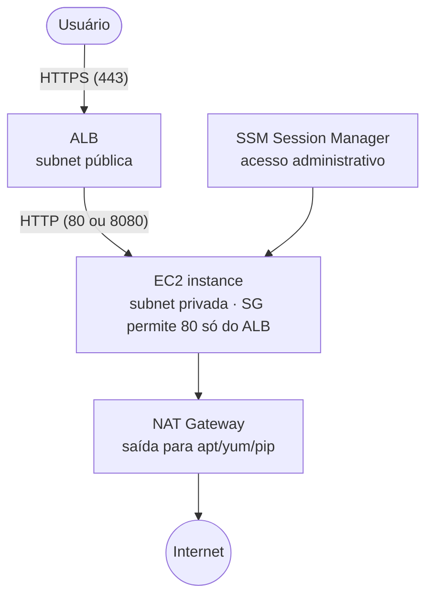

Colocar uma aplicação no ar na AWS é fácil. Colocar uma aplicação no ar
na AWS **com segurança** é outra história: envolve rede privada, controle
de acesso em várias camadas, domínio próprio, HTTPS end-to-end,
autenticação de usuários e proteção contra tráfego hostil. Este post
cobre todos esses pontos de forma prática, comparando três arquiteturas
diferentes para você escolher a que melhor cabe no seu caso.

As três arquiteturas resolvem o mesmo problema (publicar uma aplicação
web segura) com perfis bem diferentes de custo, operação e flexibilidade.
Elas compartilham o mesmo esqueleto de segurança: VPC com subnets
públicas e privadas, Route 53 e ACM para domínio e HTTPS, Cognito User
Pool para autenticação, WAF na borda e IAM com mínimo privilégio. A parte
que muda é o que roda a aplicação em si.

Este post **não cobre** como construir a aplicação, nem como fazer CI/CD
dela. O foco é o que acontece entre o código buildado e o usuário final
acessando a URL com HTTPS, autenticado e dentro de uma rede controlada.

## Custo: leia isso antes de executar qualquer comando

> [!WARNING] Vários componentes cobram por hora, ligados ou não
> Diferente de serviços pay-as-you-go como S3 ou Lambda, boa parte dos
> componentes aqui (ALB, NAT Gateway, Fargate task, EC2) cobra por hora
> alocada, independente de tráfego. Uma VPC com NAT Gateway esquecida
> custa cerca de \$32/mês sozinha, só pelo NAT, mesmo com zero bytes
> trafegando. Delete os recursos ao terminar.

Valores oficiais da AWS em outubro de 2026, região `us-east-1`:

| Componente | Modelo de cobrança | Custo aproximado |
| --- | --- | --- |
| Application Load Balancer | Por hora + LCU | ~\$16/mês + uso |
| NAT Gateway | Por hora + GB processado | ~\$32/mês + \$0,045/GB |
| Fargate task (0.5 vCPU, 1 GB) | Por segundo | ~\$14/mês contínuo |
| EC2 t3.small | Por hora | ~\$15/mês contínuo |
| API Gateway REST | Por requisição | \$3,50 por milhão |
| Lambda | Por requisição + GB-s | Praticamente grátis em baixo volume |
| CloudFront | Por GB + requisição | 1 TB/mês grátis para sempre |
| Route 53 hosted zone | Por mês | \$0,50/mês + queries |
| ACM (certificado público) | Grátis | \$0 |
| Cognito User Pool | Por MAU | 50 mil MAU/mês grátis |
| AWS WAF | Por regra + requisição | \$5/mês/web ACL + \$1/regra |

A arquitetura serverless (API Gateway + Lambda) pode ficar praticamente
de graça em volume baixo. As outras duas têm um piso mensal fixo por
causa do ALB e, dependendo do desenho, do NAT Gateway. Volte nessa
tabela sempre que precisar estimar o custo total.

Para uma visão geral de boas práticas de custo na AWS, confira o
[post sobre FinOps na AWS](/posts/finops-aws-boas-praticas).

## As três arquiteturas em uma linha

Antes de qualquer coisa, uma visão rápida das três para você se situar:

**Arquitetura 1 (corporativa): ECS Fargate + ALB + CloudFront.** Containers
rodando em subnets privadas atrás de um Application Load Balancer, com
CloudFront na frente para cache e borda. É a opção que empresas escolhem
quando a app precisa de containers, controle fino de rede e já tem time
operando ECS. Custo mensal piso: ~\$50 (ALB + NAT + task).

**Arquitetura 2 (baixo custo, serverless): API Gateway + Lambda.** Nada
de servidores, nada de ALB. API Gateway recebe o tráfego, autoriza via
Cognito e invoca Lambda. CloudFront na frente é opcional, mas vale a
pena. Custo piso: perto de zero. Escala para milhões sem você mexer.
Para fundamentos de Lambda, veja o
[post sobre AWS Lambda](/posts/aws-lambda-introducao).

**Arquitetura 3 (didática): EC2 em subnet privada + ALB.** Uma ou mais
instâncias EC2 numa subnet privada, atrás de um ALB público. Acesso
administrativo via SSM Session Manager (sem bastion, sem porta 22
aberta). É a mais "manual", excelente para entender o que as outras
duas abstraem. Custo piso parecido com a arquitetura 1.

Trade-offs resumidos:

| Critério | ECS Fargate | API Gateway + Lambda | EC2 + ALB |
| --- | --- | --- | --- |
| Custo mínimo mensal | ~\$50 | ~\$1 | ~\$50 |
| Escala automática | Sim (ECS Service) | Sim (nativa) | Sim (ASG) |
| Cold start | Não | Sim (ms a s) | Não |
| Controle do runtime | Alto (container) | Baixo (runtime fixo) | Total (SO) |
| Complexidade operacional | Média | Baixa | Alta |
| Melhor para | Apps longas, workers | APIs event-driven | Aprender, legados |

Escolha pela coluna que menos dói. Se você tem container pronto e tráfego
previsível, Fargate. Se é API com tráfego irregular, Lambda. Se precisa
de controle total do SO ou está migrando um legado, EC2.

## Pré-requisitos

- **Conta AWS** com permissões de administrador (para testes). Em produção,
  use IAM com mínimo privilégio.
- **AWS CLI v2** instalada e configurada (`aws configure`). Vamos usar
  comandos pontuais; o grosso é via console para facilitar a leitura.
- **Um domínio registrado** (pode ser no Route 53 ou em qualquer registrar,
  desde que você consiga apontar os nameservers). Sem domínio, não dá
  para ter HTTPS com certificado válido para usuário final.
- **Noções de VPC, IAM e grupos de segurança.** Este post explica os
  pontos relevantes, mas não é introdução a cada serviço.
- **Container pronto (para arquitetura 1)** ou **função Lambda com código
  (para arquitetura 2)** ou **AMI/user data preparado (para arquitetura 3)**.
  Como construir cada um fica fora do escopo.

## Fundamentos de segurança que valem para as três

Antes de descer no detalhe de cada arquitetura, vale fixar os princípios
que aparecem em todas. Se você ignorar qualquer um deles, nenhuma das
três arquiteturas é segura, por melhor que esteja o resto.

### Defense in depth: camadas, não castelos

Segurança na AWS funciona em camadas sobrepostas: borda (WAF, CloudFront),
rede (VPC, subnets, security groups, NACLs), aplicação (autenticação,
autorização), dados (criptografia em repouso e em trânsito) e identidade
(IAM). Uma falha em uma camada deve ser contida pela próxima, nunca abrir
caminho direto para o dado. Isso é o oposto de "firewall perimetral":
você assume que a borda pode falhar e desenha para que isso não seja
catastrófico.

### VPC: a fronteira que você controla

Toda arquitetura aqui vive dentro de uma **VPC** (Virtual Private Cloud):
uma rede isolada só sua, com faixa de IPs que você escolhe (ex.
`10.0.0.0/16`). Dentro dela, você cria **subnets**:

- **Subnets públicas** têm rota direta para a internet via **Internet
  Gateway**. Só colocam aqui o que precisa receber tráfego da internet:
  ALB, NAT Gateway, bastion (se tivesse).
- **Subnets privadas** não têm rota direta para a internet. Elas acessam
  a internet (para baixar pacotes, por exemplo) via **NAT Gateway** que
  mora numa subnet pública. É aqui que a sua aplicação roda.

Regra de ouro: **a aplicação nunca fica em subnet pública**. Nem Fargate,
nem Lambda em VPC, nem EC2. Quem recebe tráfego público é o ALB (ou
CloudFront, ou API Gateway), e ele conversa com a aplicação por dentro
da VPC.



Sempre crie **duas subnets públicas e duas privadas**, em
Availability Zones diferentes (ex. `us-east-1a` e `us-east-1b`). ALB
exige no mínimo duas AZs, e isso te dá alta disponibilidade de graça.

<!-- TODO: espaço reservado para print: diagrama da VPC no console AWS com subnets públicas e privadas em duas AZs -->

### Security Groups: firewall stateful por recurso

**Security Groups (SGs)** são firewalls de camada 4 anexados a cada
recurso (ENI, task, instância). São **stateful**: se você permite
entrada, a resposta sai automaticamente, não precisa configurar o
retorno.

A regra que mais importa: **SGs se referenciam entre si, não via IP**.
Em vez de "permita 10.0.11.0/24 na porta 8080", escreva "permita o SG
do ALB na porta 8080". Assim, se as subnets mudarem, nada quebra, e a
intenção fica explícita.

Exemplo típico para a arquitetura 1 (Fargate atrás de ALB):

- `sg-alb`: entrada 443 de `0.0.0.0/0` (internet). Saída livre.
- `sg-task`: entrada 8080 **só do `sg-alb`**. Saída livre (para puxar
  imagens do ECR, logs para CloudWatch etc.).

Nunca abra portas administrativas (22, 3389) para a internet. Para
acessar EC2 sem bastion, use SSM Session Manager (detalhe na arquitetura
3).

### IAM: mínimo privilégio sempre

Toda arquitetura precisa de pelo menos duas IAM Roles:

- **Role da aplicação** (task role no Fargate, execution role no Lambda,
  instance profile no EC2): define o que a app pode fazer na AWS (ler
  bucket X, publicar no SQS Y). Comece restritivo. Só adicione permissão
  quando o CloudWatch Logs mostrar `AccessDenied` para uma ação que
  realmente deveria ser permitida.
- **Role de execução/infraestrutura** (ECS execution role, por exemplo):
  usada pelo serviço AWS para operar a app (puxar imagem, mandar log).
  Essa pode ter policies gerenciadas padrão (`AmazonECSTaskExecutionRolePolicy`).

> [!TIP] Evite roles de admin em produção
> `AdministratorAccess` em role de aplicação é a origem mais comum de
> incidente de segurança na AWS. Se um atacante achar uma falha de
> SSRF na sua app, ele usa essa role inteira. Com uma role restrita,
> o dano fica contido.

### HTTPS end-to-end: ACM resolve, mas não automático

HTTPS entre usuário e borda (CloudFront ou ALB) é obrigatório e grátis
com **ACM** (AWS Certificate Manager). HTTPS entre borda e aplicação é
opcional mas recomendado: terminar TLS no ALB e falar HTTP interno é
aceitável dentro de VPC, mas se você precisa de compliance (PCI, HIPAA),
termine TLS também na aplicação ou use mTLS. Detalhes de configuração
ficam na seção de domínio e HTTPS.

## Arquitetura 1: ECS Fargate + ALB + CloudFront (corporativo)

**Quando usar:** app containerizada, tráfego previsível, time que já
opera ECS ou quer evoluir para operar. Ótimo para APIs internas de
empresa, backends de SPA, workers HTTP.

Diagrama:



### Passo 1: cluster ECS e task definition

Crie um cluster ECS tipo Fargate e uma task definition apontando para
sua imagem no ECR:

```json
// task-definition.json
{
  "family": "minha-app",
  "networkMode": "awsvpc",
  "requiresCompatibilities": ["FARGATE"],
  "cpu": "512",
  "memory": "1024",
  "executionRoleArn": "arn:aws:iam::123456789012:role/ecsTaskExecutionRole",
  "taskRoleArn": "arn:aws:iam::123456789012:role/minha-app-task-role",
  "containerDefinitions": [
    {
      "name": "app",
      "image": "123456789012.dkr.ecr.us-east-1.amazonaws.com/minha-app:latest",
      "portMappings": [{ "containerPort": 8080, "protocol": "tcp" }],
      "essential": true,
      "logConfiguration": {
        "logDriver": "awslogs",
        "options": {
          "awslogs-group": "/ecs/minha-app",
          "awslogs-region": "us-east-1",
          "awslogs-stream-prefix": "app"
        }
      }
    }
  ]
}
```

Pontos de atenção:

- `networkMode: awsvpc` dá à task uma ENI própria dentro da subnet
  privada. Isso é o que permite aplicar security group na task.
- `executionRoleArn` é a role que o ECS usa para puxar a imagem e
  escrever logs. `taskRoleArn` é a role que **a aplicação usa** para
  acessar serviços AWS. Mantenha separadas.
- `logConfiguration` manda stdout para CloudWatch Logs. Sem isso, você
  não vê nada da aplicação.

Registre com:

```bash
aws ecs register-task-definition --cli-input-json file://task-definition.json
```

### Passo 2: ALB e target group

Crie o ALB nas **duas subnets públicas**, com SG permitindo entrada 443
só do CloudFront (próxima etapa). Target group aponta para a porta 8080
das tasks, tipo `ip` (obrigatório com `awsvpc`).

Health check do target group: path tipo `/health` retornando 200. Se a
app não tem health endpoint, crie um que retorne só `OK`. Sem health
check saudável, o ALB nunca manda tráfego.

### Passo 3: ECS Service

```bash
aws ecs create-service \
  --cluster meu-cluster \
  --service-name minha-app \
  --task-definition minha-app \
  --desired-count 2 \
  --launch-type FARGATE \
  --network-configuration "awsvpcConfiguration={subnets=[subnet-priv-a,subnet-priv-b],securityGroups=[sg-task],assignPublicIp=DISABLED}" \
  --load-balancers "targetGroupArn=arn:...,containerName=app,containerPort=8080"
```

Pontos importantes:

- `assignPublicIp=DISABLED`: a task **não ganha IP público**, fica
  isolada em subnet privada. Para puxar imagem do ECR e logs, use NAT
  Gateway ou **VPC Endpoints** para ECR, S3 e CloudWatch Logs (mais
  barato se tráfego interno for alto).
- `desired-count 2`: duas tasks em AZs diferentes. ECS Service faz o
  balanceamento sozinho.

<!-- TODO: espaço reservado para print: console do ECS mostrando o Service com 2/2 tasks running em AZs diferentes -->

### Passo 4: CloudFront na frente

Crie uma distribuição CloudFront com o ALB como origem. Configure:

- **Viewer protocol policy**: `Redirect HTTP to HTTPS`.
- **Origin protocol policy**: HTTPS (ou HTTP se terminar TLS no ALB).
- **Cache policy**: para API, use `CachingDisabled` como ponto de
  partida. Para conteúdo estático servido pela app, use `CachingOptimized`.
- **Origin request policy**: `AllViewer` para repassar cabeçalhos e
  cookies.
- **Alternate domain names**: `app.seudominio.com` (precisa do certificado
  ACM na região `us-east-1`, obrigatório para CloudFront).

Para fechar o ALB só ao CloudFront, use **AWS managed prefix list**
`com.amazonaws.global.cloudfront.origin-facing` no SG do ALB em vez de
`0.0.0.0/0`. Isso impede que alguém descubra o DNS do ALB e passe por
cima do CloudFront e do WAF.

> [!TIP] Custom header como segundo cadeado
> Além da prefix list, configure o CloudFront para injetar um header
> `X-Origin-Verify: <segredo>` e faça o ALB rejeitar requisições sem
> esse header via listener rule. Dois cadeados, mesma porta.

## Arquitetura 2: API Gateway + Lambda (baixo custo, serverless)

**Quando usar:** API HTTP/REST, tráfego irregular (de zero a picos),
time pequeno, baixo apetite para operar servidor. Fica literalmente
gratuita abaixo de ~1 milhão de requisições por mês.

Diagrama:



Diferenças em relação à arquitetura 1:

- Sem ALB, sem NAT Gateway (se Lambda não precisa de VPC). Já economiza
  ~\$48/mês.
- Sem container, sem health check, sem desired count. API Gateway e
  Lambda escalam sozinhos.
- Cold start existe. Para APIs latência-sensíveis, use **provisioned
  concurrency** (volta a cobrar por hora, cuidado).

### Passo 1: função Lambda

Crie a função com runtime (Python, Node, etc.), código mínimo e role
restrita. Role padrão deve ter só `AWSLambdaBasicExecutionRole` (logs
no CloudWatch) e as policies específicas de recursos que a função
acessa. Para fundamentos, veja o
[post sobre AWS Lambda](/posts/aws-lambda-introducao).

Se a Lambda precisa acessar recurso dentro da VPC (RDS, por exemplo),
configure VPC/subnets/SG. **Só coloque em VPC se precisar**: Lambda em
VPC fica atrás de ENIs, aumenta cold start e exige NAT Gateway se
precisar de internet.

### Passo 2: API Gateway

Dois sabores:

- **REST API**: mais features (API keys, usage plans, request validation,
  mapping templates). Mais caro.
- **HTTP API**: mais barato (~70%), mais rápido, menos features. Para a
  maioria dos casos, basta.

Vamos com HTTP API. Crie rotas (`GET /items`, `POST /items`) apontando
para a Lambda como integração. Deploy em stage (`prod`).

Autorização via Cognito User Pool (configurada na próxima seção):

```json
{
  "AuthorizationType": "JWT",
  "JwtConfiguration": {
    "Issuer": "https://cognito-idp.us-east-1.amazonaws.com/us-east-1_XXXX",
    "Audience": ["<app-client-id>"]
  },
  "IdentitySource": ["$request.header.Authorization"]
}
```

Cada rota declara se é protegida. Rotas públicas (ex. `GET /health`)
não precisam do authorizer.

### Passo 3: resource policy (opcional, mas poderoso)

Se a API deve ser acessível só a partir do CloudFront (ou de IPs
específicos), aplique uma **resource policy** no API Gateway:

```json
{
  "Version": "2012-10-17",
  "Statement": [
    {
      "Effect": "Deny",
      "Principal": "*",
      "Action": "execute-api:Invoke",
      "Resource": "arn:aws:execute-api:us-east-1:123456789012:abcd/*",
      "Condition": {
        "StringNotEquals": {
          "aws:SourceVpce": "vpce-0123456789abcdef0"
        }
      }
    }
  ]
}
```

Esse exemplo bloqueia tudo que não venha de um VPC Endpoint específico.
Variantes comuns: bloquear por IP, por conta AWS de origem, por
`aws:SourceArn` do CloudFront.

### Passo 4: CloudFront na frente (opcional mas recomendado)

API Gateway já tem HTTPS, mas colocar CloudFront na frente dá:

- Domínio próprio simples (um só certificado, em `us-east-1`).
- WAF (API Gateway também aceita WAF direto, mas CloudFront fica mais
  barato por volume).
- Cache de respostas públicas quando aplicável.

Configure o CloudFront com o endpoint do API Gateway como origem e um
header customizado `X-Origin-Verify` que o API Gateway valida via
resource policy. Mesmo truque da arquitetura 1.

> [!NOTE] Lambda@Edge vs CloudFront Functions
> Para lógica simples na borda (reescrever header, redirect, geoblock
> leve), **CloudFront Functions** é mais barato e mais rápido que
> Lambda@Edge. Lambda@Edge só vale a pena quando você precisa de
> runtime completo (chamar outra AWS API, ler segredo).

## Arquitetura 3: EC2 em subnet privada + ALB (didático)

**Quando usar:** você está aprendendo e quer ver cada peça com clareza,
ou está migrando um legado que precisa de controle total do SO
(agentes antigos, pacotes específicos, licença amarrada a instância).
Em produção nova, prefira as outras duas.

Diagrama:



### Passo 1: AMI e user data

Escolha uma AMI gerenciada (Amazon Linux 2023 é um bom default). O
`user data` roda uma vez no primeiro boot e é onde você instala e sobe
a aplicação:

```bash
#!/bin/bash
dnf update -y
dnf install -y python3 python3-pip
pip3 install gunicorn minha-app
cat > /etc/systemd/system/app.service <<'EOF'
[Unit]
Description=Minha app
After=network.target

[Service]
ExecStart=/usr/local/bin/gunicorn -b 0.0.0.0:8080 minha_app:app
Restart=always
User=app

[Install]
WantedBy=multi-user.target
EOF
useradd -r app
systemctl enable --now app
```

Para apps mais sérias, builde uma AMI própria (Packer) ou um container
e migre para a arquitetura 1. User data é ótimo para aprender, ruim
para repetibilidade.

### Passo 2: instance profile com SSM

A instância **não deve ter chave SSH associada**. O acesso administrativo
vai ser via **SSM Session Manager**: você abre um shell direto no console
ou via CLI, sem porta 22 aberta, sem bastion, com log de sessão no
CloudWatch.

Para isso funcionar, crie uma IAM role (instance profile) com a policy
gerenciada `AmazonSSMManagedInstanceCore`. Anexe à instância. O agente
SSM já vem instalado nas AMIs oficiais Amazon Linux.

Conectar:

```bash
aws ssm start-session --target i-0abc123def456
```

Caiu dentro da instância, sem nunca ter aberto a 22. Toda sessão fica
logada; você pode auditar quem entrou e o que digitou.

> [!TIP] SSM Session Manager > bastion
> Bastion host é padrão antigo: custa VM extra, exige rotação de chaves,
> expõe porta SSH. SSM resolve com IAM, log central e zero portas
> abertas. Em projeto novo, não use bastion.

### Passo 3: Auto Scaling Group e Launch Template

Em vez de uma instância solta, use **Launch Template** + **Auto Scaling
Group (ASG)** com no mínimo duas AZs e capacidade mínima 2. O ASG:

- Substitui instância que fica unhealthy (ALB avisa).
- Escala para cima/baixo com base em métricas (CPU, requests por target).
- Garante que sempre tenha instância em AZs diferentes.

Target group do ALB aponta para o ASG, não para IPs fixos. Instância
subiu, registrou-se no target group, começou a receber tráfego. Caiu,
foi desregistrada, substituída.

### Passo 4: patches e hardening

EC2 é o único dos três onde **você é responsável pelo SO**. Isso inclui:

- **Patches**: use SSM Patch Manager com uma maintenance window
  (ex. domingo 03h). Senão, instâncias viram alvo fácil.
- **Antivírus/EDR** se exigido por compliance.
- **CloudWatch Agent** para métricas de memória e disco (CPU já vem
  nativo, mas memória não).
- **IMDSv2 obrigatório** no Launch Template (`HttpTokens: required`).
  IMDSv1 é vulnerável a SSRF; não use.

Isso tudo é trabalho que Fargate e Lambda fazem por você. É o preço do
controle.

## Domínio e HTTPS: Route 53 + ACM

Essa parte é comum às três arquiteturas e vale a pena fazer antes de
expor qualquer endpoint ao usuário final.

### Passo 1: hosted zone no Route 53

Mesmo que o domínio esteja em outro registrar (GoDaddy, Registro.br),
crie uma **hosted zone** no Route 53. Você vai usar essa hosted zone
para gerenciar os registros e, no registrar externo, só aponta os
**nameservers** do Route 53.

```bash
aws route53 create-hosted-zone \
  --name seudominio.com \
  --caller-reference $(date +%s)
```

A resposta traz quatro nameservers (`ns-123.awsdns-...`). Configure
eles no registrar e aguarde a propagação (de minutos a algumas horas).

### Passo 2: certificado ACM

Peça um certificado público para o nome do seu app
(`app.seudominio.com`). ACM é grátis para uso em serviços AWS
integrados (ALB, CloudFront, API Gateway).

> [!WARNING] Região do certificado importa
> Certificado para **ALB** fica na mesma região do ALB. Certificado para
> **CloudFront** precisa estar em `us-east-1`, sempre, independente de
> onde a app roda. Peça dois certificados se usa CloudFront + ALB em
> outra região.

```bash
aws acm request-certificate \
  --domain-name app.seudominio.com \
  --validation-method DNS \
  --region us-east-1
```

**Validação DNS, não email**. ACM mostra um CNAME que você precisa
criar na hosted zone. Faça isso no mesmo Route 53 (um clique no console:
"Create records in Route 53"). Em poucos minutos, o certificado fica
`Issued`.

### Passo 3: registro alias para o endpoint

Com o certificado válido, anexe-o ao CloudFront/ALB/API Gateway e crie
um **alias record** apontando `app.seudominio.com` para o endpoint:

- Para CloudFront: alias para o domínio `d123abc.cloudfront.net`.
- Para ALB: alias para o DNS do ALB (`minha-app-123.us-east-1.elb.amazonaws.com`).
- Para API Gateway: alias para o custom domain (`d-abc123.execute-api...`).

Alias é um registro específico do Route 53 que resolve direto para o
recurso AWS, sem custo de query e sem precisar atualizar manualmente
quando o IP muda.

### Passo 4: forçar HTTPS

Configure redirecionamento HTTP (80) para HTTPS (443) na borda:

- **CloudFront**: `Viewer protocol policy` = `Redirect HTTP to HTTPS`.
- **ALB**: criar listener na 80 com default action `redirect to 443`.
- **API Gateway**: só aceita HTTPS por padrão, nada a fazer.

E habilite **HSTS** (HTTP Strict Transport Security) via header
`Strict-Transport-Security: max-age=63072000; includeSubDomains; preload`
na resposta. No CloudFront, use **Response Headers Policy** com a
política gerenciada `SecurityHeadersPolicy` como ponto de partida.

> [!TIP] Teste com SSL Labs
> Depois de configurar, rode `https://www.ssllabs.com/ssltest/` no seu
> domínio. Nota A ou A+ é alvo razoável. CloudFront com cipher suite
> padrão já entrega A.

## Autenticação com Cognito User Pool

Até aqui, qualquer um com a URL acessa a aplicação. Agora vamos exigir
que o usuário faça login antes de passar pelo ALB ou API Gateway.

**Cognito User Pool** é o serviço gerenciado da AWS para diretório de
usuários: cadastro, login, MFA, recuperação de senha, federação com
Google/Microsoft/SAML. Ele emite tokens JWT (ID token e access token)
que o ALB e o API Gateway sabem validar nativamente.

### Passo 1: criar o User Pool

No console, **Cognito → User Pools → Create user pool**. Pontos que
importam:

- **Sign-in options**: email ou username. Para apps modernas, email.
- **Password policy**: mínimo 8 caracteres com complexidade. Para
  produção séria, 12+.
- **MFA**: `Optional` ou `Required`. TOTP (app autenticador) é melhor
  que SMS (SMS pode ser interceptado, custa mais e cai no total gratuito
  da camada SMS da AWS).
- **Self-service sign-up**: habilitar só se usuários realmente se
  cadastram sozinhos. Em app corporativa, geralmente admin cria.
- **Email**: para desenvolvimento, Cognito manda do endereço
  `no-reply@verificationemail.com`. Para produção, configure SES com
  domínio verificado.

Anote o **User Pool ID** (ex. `us-east-1_ABCdef123`).

### Passo 2: App Client

Dentro do User Pool, crie um **App Client**:

- Nome: `minha-app-web`.
- **Client secret**: desabilitado para front-end SPA, habilitado para
  back-end (ALB usa com secret).
- **Allowed OAuth flows**: `Authorization code grant` (nunca `Implicit`
  em produção).
- **Allowed callback URLs**: `https://app.seudominio.com/oauth2/idpresponse`
  (para ALB) ou a URL do seu front (para SPA).
- **Allowed OAuth scopes**: `openid`, `email`, `profile`.

Habilite o **Hosted UI** e configure um **domínio Cognito** (ex.
`minha-app.auth.us-east-1.amazoncognito.com`) ou um domínio customizado
(exige certificado ACM em `us-east-1`).

### Passo 3a: integração com ALB (arquiteturas 1 e 3)

ALB tem autenticação Cognito nativa via **listener rule**. No listener
HTTPS do ALB, antes da action `forward to target group`, adicione uma
action `authenticate-cognito`:

```json
{
  "Type": "authenticate-cognito",
  "AuthenticateCognitoConfig": {
    "UserPoolArn": "arn:aws:cognito-idp:us-east-1:123456789012:userpool/us-east-1_ABCdef123",
    "UserPoolClientId": "<app-client-id>",
    "UserPoolDomain": "minha-app",
    "SessionTimeout": 604800,
    "Scope": "openid email profile",
    "OnUnauthenticatedRequest": "authenticate"
  }
}
```

O que acontece: usuário sem sessão é redirecionado para o Hosted UI do
Cognito, faz login, volta para o ALB, que valida o código, troca por
tokens, cria uma sessão (cookie `AWSELBAuthSessionCookie`) e manda a
requisição para a task com headers extras:

- `x-amzn-oidc-identity`: ID do usuário no Cognito.
- `x-amzn-oidc-accesstoken`: access token JWT.
- `x-amzn-oidc-data`: ID token assinado pelo ALB (você valida a
  assinatura na app).

Autenticação resolvida sem código na aplicação. A app só lê o header
`x-amzn-oidc-data` para saber quem é o usuário.

> [!WARNING] Valide a assinatura do x-amzn-oidc-data
> Se a app aceitar `x-amzn-oidc-data` sem validar a assinatura, qualquer
> um que descobrir o DNS do ALB e passar o header forjado vira
> "usuário autenticado". Valide com a chave pública do ALB (publicada
> em um endpoint regional da AWS) ou feche o ALB ao CloudFront com
> prefix list + custom header, como discutido antes.

### Passo 3b: integração com API Gateway (arquitetura 2)

API Gateway valida JWT nativamente via **JWT authorizer** (HTTP API) ou
**Cognito authorizer** (REST API). O front-end chama o Hosted UI, obtém
o token, e manda em `Authorization: Bearer <token>` em cada requisição.

Configuração do JWT authorizer já ficou no bloco da arquitetura 2.
`Issuer` é o endpoint do User Pool, `Audience` é o App Client ID.

Para autorização mais granular (ex. só admins acessam `/admin/*`),
inclua **groups** no Cognito e cheque o claim `cognito:groups` no
token, seja no API Gateway (via Lambda authorizer) ou na própria
Lambda.

### Passo 4: cadastro inicial e MFA

Para app corporativa, crie usuários via CLI ou SDK:

```bash
aws cognito-idp admin-create-user \
  --user-pool-id us-east-1_ABCdef123 \
  --username joao@empresa.com \
  --user-attributes Name=email,Value=joao@empresa.com Name=email_verified,Value=true \
  --desired-delivery-mediums EMAIL
```

Cognito envia email com senha temporária. No primeiro login, o usuário
troca a senha e, se MFA for required, configura o TOTP.

## WAF, logs e monitoramento

Com rede, HTTPS e autenticação no lugar, falta a camada de borda contra
tráfego hostil e a observabilidade para saber que a coisa está
funcionando (e para investigar quando não estiver).

### AWS WAF: regras gerenciadas resolvem 90%

Crie uma **Web ACL** e associe ao CloudFront, ALB ou API Gateway. As
regras gerenciadas da AWS cobrem a maior parte dos ataques comuns:

- `AWSManagedRulesCommonRuleSet`: OWASP Top 10 básico, body size,
  path traversal.
- `AWSManagedRulesKnownBadInputsRuleSet`: payloads conhecidos (log4shell,
  por exemplo).
- `AWSManagedRulesSQLiRuleSet`: SQL injection.
- `AWSManagedRulesAmazonIpReputationList`: IPs reputados como maliciosos.
- `AWSManagedRulesBotControlRuleSet`: detecção de bots (cobra extra).

Adicione também uma regra customizada de **rate limiting**:

```json
{
  "Name": "RateLimitPerIP",
  "Priority": 10,
  "Statement": {
    "RateBasedStatement": {
      "Limit": 2000,
      "AggregateKeyType": "IP"
    }
  },
  "Action": { "Block": {} },
  "VisibilityConfig": { "SampledRequestsEnabled": true, "CloudWatchMetricsEnabled": true, "MetricName": "RateLimitPerIP" }
}
```

Limite de 2000 requisições por IP em 5 minutos é razoável para APIs
normais. Ajuste conforme o perfil de tráfego real.

> [!TIP] Comece com Count, depois Block
> Rode as regras em modo `Count` por uma semana e olhe as métricas no
> CloudWatch. Se nenhum falso positivo aparecer, troque para `Block`.
> Em prod ativa, ligar `Block` sem observar derruba tráfego legítimo.

### Logs: o que ligar

- **CloudWatch Logs** para app (já vem via log driver no Fargate,
  CloudWatch Agent no EC2, nativo no Lambda).
- **ALB access logs** em bucket S3. Formato denso, dá para analisar com
  Athena.
- **CloudFront access logs** idem, em bucket próprio.
- **VPC Flow Logs** no nível da VPC, em CloudWatch Logs ou S3. Essencial
  para investigar "quem conversou com quem".
- **WAF logs** em CloudWatch Logs ou S3. Permite ver o que foi bloqueado
  e por qual regra.
- **CloudTrail** sempre ligado (todas as regiões, log file validation).
  É o audit log de todas as chamadas de API na conta.

### Monitoramento mínimo

- Alarme no CloudWatch para **5xx** acima de X por minuto no ALB/API GW.
- Alarme para **TargetResponseTime** acima de Y (SLO da sua app).
- Alarme para **HealthyHostCount == 0** no target group.
- Alarme para **custo**: Budget mensal com alerta em 80%. Simples e
  salva de surpresa.

### GuardDuty: ativar e esquecer

**Amazon GuardDuty** é um serviço de detecção de ameaças que lê
CloudTrail, VPC Flow Logs e DNS logs em segundo plano procurando padrão
suspeito (ex. instância conversando com IP de botnet conhecido). Custa
pouco em contas pequenas, ativa em um clique, manda achados para
EventBridge. Em qualquer conta minimamente séria, deixe ligado.

## Observações importantes

Alguns pontos que não cabem em uma seção específica mas pegam todo
mundo em algum momento.

**NAT Gateway é o vilão silencioso do extrato.** \$32/mês de piso **por
AZ**, mais \$0,045 por GB processado. Se a app faz muito tráfego para
internet (puxar imagens grandes do ECR, por exemplo), use **VPC
Endpoints** de interface para ECR, S3, CloudWatch Logs, Secrets
Manager. Cada endpoint custa menos que o tráfego pelo NAT em volume
médio.

**ALB cobra por LCU, não só por hora.** Cada LCU inclui 25 conexões
novas/s, 3000 conexões ativas, 1 GB processado e 1000 regras. Em app
pequena, você fica dentro de 1 LCU e paga só a hora. Em volume alto,
monitore o custo de LCU.

**Lambda em VPC + NAT Gateway é armadilha.** Se a Lambda chama só APIs
AWS, prefira **VPC endpoints** em vez de NAT Gateway. Mais barato e
mais seguro (tráfego não sai da AWS).

**Troque chaves de acesso por IAM Roles.** Nunca coloque access key +
secret dentro de container, instância, ou Lambda. Use role (task role,
instance profile, execution role) e deixe o SDK pegar credencial
temporária via metadata.

**Rotacione segredos no Secrets Manager, não hardcode.** Senhas de
banco, API keys de terceiros, qualquer coisa sensível vai no Secrets
Manager com rotação habilitada. A role da aplicação lê o segredo em
runtime via SDK.

**Multi-conta é padrão em escala.** Para projetos pequenos, uma conta
basta. A partir de um certo tamanho, separe em contas (dev, staging,
prod) via AWS Organizations. Isso é defesa real: falha em dev não
contamina prod.

**Limpeza ao terminar.** Se montou o laboratório só para aprender,
delete nessa ordem para evitar bloqueios de dependência:

1. CloudFront (desabilitar + delete, demora ~15 min).
2. ECS Service (set desired count 0 → delete) ou Lambda.
3. ALB e target groups.
4. NAT Gateway (demora ~5 min para sumir).
5. VPC Endpoints.
6. Cognito User Pool (opcional, não cobra parado).
7. Hosted Zone no Route 53 (cobra \$0,50/mês parada).
8. VPC inteira (só delete depois que o resto saiu).

ACM certificate pode ficar, não cobra. CloudWatch logs vão expirando
sozinhos se você configurou retenção (recomendado: 30 dias para log
de app, 90+ para audit).

## Recapitulando

Você viu três arquiteturas completas para publicar uma aplicação na
AWS com segurança: **ECS Fargate** para quem quer container
corporativo, **API Gateway + Lambda** para quem quer baixo custo e
escala serverless, **EC2 em subnet privada** para quem precisa de
controle total ou está aprendendo. As três compartilham o mesmo
esqueleto: VPC bem desenhada, security groups referenciando security
groups, IAM com mínimo privilégio, Route 53 + ACM para domínio e
HTTPS, Cognito User Pool para autenticação, WAF na borda e
observabilidade com CloudWatch + CloudTrail + GuardDuty.

A segurança boa na AWS não é um botão, é um conjunto de decisões
pequenas e disciplinadas em cada camada. Comece simples, meça custo
desde o primeiro dia, e evolua conforme a app ganha tráfego e
exigências. O custo de deixar uma dessas peças de fora quase sempre
aparece depois, e cobra juros.
